<div align="center">



<br />

[](https://git.io/typing-svg)

[](https://github.com/zthiagoferr)
[](https://github.com/zthiagoferr/portfolio)
[](mailto:contato.thiagofo@icloud.com)
[](https://github.com/zthiagoferr)

</div>

---

## `> whoami` 🧑‍💻

Desenvolvedor **Full Stack**, criando soluções de ponta a ponta: **interfaces modernas e responsivas, aplicações web, APIs REST, automações, integrações, bancos de dados e deploy**. Trabalho com **React, TypeScript, JavaScript, Python e FastAPI**, conectando experiência do usuário, regras de negócio e infraestrutura. Meu foco é entregar software **bem estruturado, testado e documentado**.



<details>
<summary><b>⚡ Abrir meu manifesto de desenvolvimento</b></summary>
<br />

```python
class Thiago:
    foco = ["Frontend", "Backend", "APIs REST", "Automação"]
    stack = ["React", "TypeScript", "Python", "FastAPI", "PostgreSQL"]

    def construir(self, problema):
        return "Entender → Projetar → Testar → Entregar → Evoluir"
```

**Como penso:** código legível, arquitetura coerente, observabilidade, boas práticas, testes e evolução contínua.
</details>

## `> tech_stack --visual` 🛠️

<div align="center">

**Frontend & experiência do usuário**


**Backend, APIs & dados**


**Infra, CI/CD & qualidade**


</div>

---

## `> featured_projects --production` 🚀

### 🤖 [DevPilot AI — Plataforma de análise e revisão de código](https://github.com/zthiagoferr/devpilot-ai)

**Projeto principal.** Aplicação web que analisa código Python, destaca erros e oportunidades de melhoria, permite selecionar arquivos em repositórios públicos e mantém histórico de análises.

`FastAPI` · `SQLAlchemy` · `PostgreSQL/Neon` · `Alembic` · `Pytest` · `Playwright` · `GitHub Actions` · `Render`

**Destaques:** API REST, dashboard, histórico persistente, testes automatizados, frontend separado do backend e deploy.

[](https://github.com/zthiagoferr/devpilot-ai)
[](https://zthiagoferr.github.io/devpilot-ai/)

### 🥟 [Casa do Pastel Judá — Bot de pedidos](https://github.com/zthiagoferr/pastelaria-bot)

Fluxo automatizado de vendas no Telegram com **cardápio, carrinho, checkout, Pix/Mercado Pago, promoções e painel administrativo**.

`Python` · `Telegram` · `PostgreSQL` · `Alembic` · `Render` · `HTML/CSS/JS`

### 🌐 [DevShowcase — Aplicação Full Stack](https://github.com/zthiagoferr/devshowcase)

API REST em FastAPI + interface React, CRUD e publicação em Render/Vercel.

### 🔐 [Task Manager API](https://github.com/zthiagoferr/task-manager-api)

Gerenciador de tarefas com autenticação JWT, aplicativo desktop CustomTkinter, Docker e deploy no Railway.

<details>
<summary><b>📦 Explorar outros projetos (clique para expandir)</b></summary>
<br />

| Projeto | O que demonstra |
|:--|:--|
| [🔗 URL Shortener](https://github.com/zthiagoferr/url-shortener) | Encurtamento, redirecionamento, métricas de cliques e API assíncrona. |
| [🔔 Notification Service](https://github.com/zthiagoferr/notification-service) | Notificações por e-mail, push, in-app, WebSocket e integração com Telegram. |
| [📄 Portfólio pessoal](https://github.com/zthiagoferr/portfolio) | Landing page, projetos, certificações e apresentação profissional. |
| [📚 Estudos em Python](https://github.com/zthiagoferr/estudos) | Trilha em 10 fases, exemplos comentados e exercícios práticos. |

</details>

---

## `> github_metrics --live` 📈

<div align="center">


</div>

> Estatísticas externas podem ficar temporariamente indisponíveis por limites ou manutenção dos serviços. As linguagens refletem repositórios, não necessariamente domínio técnico.

## `> currently_building` 🧪

- 🔭 Aplicações Full Stack, interfaces React, APIs REST e integrações com Python.
- 🌱 Arquitetura Full Stack, experiência do usuário, engenharia de software e qualidade.
- 🧠 Interesse em automação, agentes de IA e ferramentas para desenvolvedores.
- 🎯 Objetivo: construir produtos que resolvam problemas concretos e sejam fáceis de evoluir.

## `> connect --with-me` 📬

<div align="center">

[](mailto:contato.thiagofo@icloud.com)
[](https://instagram.com/_zthiagof)
[](https://wa.me/5511945100692)
[](https://gitlab.com/thia80.ferreira)


<sub>Feito com 🖤, frontend, backend e uma boa dose de curiosidade. | Thiago Ferreira de Oliveira</sub>

</div>
